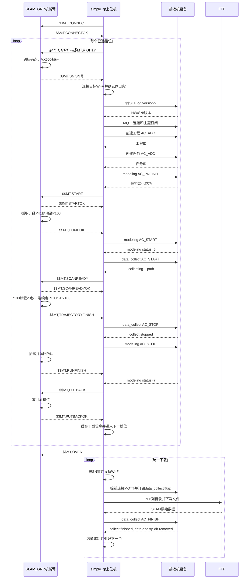
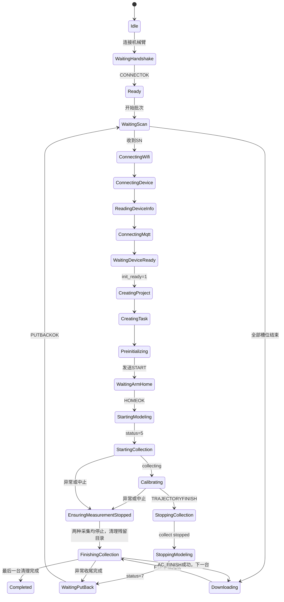

# simple_qt 与 SLAM_GRR：SLAM 标定开发说明手册

## 1. 工程范围

SLAM 标定由两个工程配合完成：

- `simple_qt`：Windows Qt 上位机，负责任务编排、设备 Wi-Fi、设备信息、MQTT、FTP、槽位结果和异常恢复。
- `SLAM_GRR`：Dobot CR10V-IS Lua 工程，负责扫码、抓放、P100～P7100 标定轨迹以及 TCP 响应。

相关源码：

| 模块 | 文件 |
| --- | --- |
| 上位机入口 | `simple_qt/src/main.cpp` |
| SLAM 后端 | `simple_qt/src/tcpcontroller.cpp/.h` |
| SLAM 界面 | `simple_qt/qml/Main.qml` |
| 机械臂程序 | `SLAM_GRR/src0.lua` |
| 机械臂点位 | `SLAM_GRR/point.json` |
| 机械臂工程定义 | `SLAM_GRR/prj.json` |

## 2. 系统架构

默认地址：

| 服务 | 地址 |
| --- | --- |
| 机械臂 TCP Server | `192.168.5.1:6601` |
| 设备信息 TCP | `192.168.1.8:25001` |
| MQTT | `192.168.1.8:1883`，失败后尝试 `26001` |
| FTP | `ftp://192.168.1.8:21/`，账号密码均为 `ftpuser` |

## 3. 完整标定时序



`HOMEOK` 是历史协议名称，当前语义是“设备已夹取并稳定到达 P100”，不是停在 P41/Home。

## 4. 上位机状态机



完整状态枚举位于 `TcpController::FlowState`，还包括 `Recovering`、`Aborted` 等异常收尾状态。

## 5. 机械臂 TCP 协议

### 5.1 分帧规则

- 上位机请求以 `\r\n` 结束。
- 机械臂 `sendFrame()` 给响应追加 `$*`。
- 两端均使用持久缓冲区，兼容半包和粘包。
- 上位机按最早出现的 `\r\n`、`\n`、`$*` 拆帧。
- 机械臂按最早出现的 `\n`、`$*` 拆帧。
- 不完整数据留待下一次读取；缓存超过 8192 字节才清空。

### 5.2 命令表

| 上位机请求 | 机械臂响应 | 说明 |
| --- | --- | --- |
| `$$MT,CONNECT` | `$$MT,CONNECTOK` | 应用层握手 |
| `$$MT,LEFT,n` | `$$MT,SN,<sn>` | 左托盘槽位 1～8 扫码 |
| `$$MT,RIGHT,n` | `$$MT,SN,<sn>` | 右托盘槽位 1～8 扫码 |
| `$$MT,START` | `STARTOK`、`HOMEOK` | 抓取并移动到 P100 |
| `$$MT,SCANREADY` | `SCANREADYOK` | 放行标定轨迹 |
| 无 | `TRAJECTORYFINISH` | P7100 实测到位，立即停止采集 |
| 无 | `RUNFINISH` | 安全抬高并返回 P41 |
| `$$MT,PUTBACK` | `PUTBACKOK` | 放回原托盘原槽位 |
| `$$MT,FAILED` | `PUTBACKOK`/`FAILEDOK` | 异常处理 |
| `$$MT,OVER` | `OVER` | 批次完成 |

主要失败响应：

- `FAILED,SCAN,<side>,<slot>`：扫码 5 次失败。
- `FAILED,SLOT,<n>`：槽位越界。
- `FAILED,BUSY`：仍夹持上一台设备。
- `FAILED,GRIPPER`：夹爪未就绪。
- `FAILED,STATE,START/SCANREADY`：状态不匹配。
- `FAILED,MOTION,P100_START/TRAJECTORY_END/EXIT/HOME`：位姿未确认，禁止自动放回并要求人工恢复。

## 6. 托盘、抓取和标定轨迹

| 点位 | 用途 |
| --- | --- |
| P21～P24 | 左托盘夹取网格四角 |
| P27～P30 | 左托盘扫码网格四角 |
| P31～P34 | 右托盘扫码网格四角 |
| P35～P38 | 右托盘夹取网格四角 |
| P41 | Home/安全过渡点 |
| P50 | 低位回 Home 时动态写入的安全抬升点 |
| P100 | SLAM 采集起点 |
| P200～P7100 | 连续标定轨迹 |
| P7100 | 标定采集终点 |

抓取流程：扫码点直线上升 150 mm → 夹取点上方 150 mm → 低速垂直下降 → 夹紧 → 垂直抬升 → 经 P41 到 P100。

轨迹流程：

1. `moveToSlamStart()` 使用 `VelJ(5)`、`AccJ(10)` 到 P100。
2. 实际位姿连续 3 次满足位置 8 mm、姿态 5°容差，才发送 `HOMEOK`。
3. 收到 `SCANREADY` 后在 P100 静置 20 秒。
4. 设置 `CP(100)`，连续提交 P100、P200……P7100 的 `MovJ`，中间没有 `Wait`。
5. P7100 连续 3 次到位后发送 `TRAJECTORYFINISH`。
6. 恢复 `CP(0)`，沿用户坐标 Z 抬高 400 mm，然后以 `VelJ(10)` 返回 P41。
7. P41 到位后发送 `RUNFINISH`。

P41 回程属于安全动作，不写入本次标定数据。

## 7. 设备信息协议

连接 `192.168.1.8:25001` 后发送：

```text
unlogall thisport\r\n  //取消当前 TCP 连接端口上的所有周期报文订阅。
$$SI\r\n  //查询设备基本信息
log versionb\r\n  //请求设备返回 VERSIONB 版本信息报文
```

- `$$SI` 为 62 字节帧，前 61 字节 XOR，最后一字节是 CRC；偏移 29、长度 3 为硬件号。
- 文本兼容 JSON `{sn,hw,version}` 和普通 `SN/HW/VERSION` 键值形式。
- 当前流程取得有效硬件号后即可进入 MQTT；业务 SN 以机械臂扫码值为主。

## 8. MQTT/OpenAPI 协议

### 8.1 订阅主题（设备响应）

前五个主题返回的是 protobuf 二进制 message，最后一个 `data_collect` 返回 UTF-8 JSON。protobuf 若直接按字符串打印会显示乱码，必须按字段号解析。

| 设备返回主题 | QoS | Payload/message | 当前上位机读取内容 |
| --- | ---: | --- | --- |
| `slam_app/report/device_status` | 0 | `DeviceStatusReport` | 字段4 `init_ready`；字段5 `Error` |
| `slam_app/response/project` | 1 | `ProjectResponse` | 字段2 `Error`；字段3 `action`；字段4 `ProjectInfo` |
| `slam_app/response/task` | 1 | `TaskResponse` | 字段2 `Error`；字段3任务ID；字段4 `action` |
| `slam_app/response/modeling` | 1 | `ModelingResponse` | 字段2 `Error`；字段3 `action` |
| `slam_app/report/modeling` | 0 | `ModelingReport` | 字段2进度；字段4扫描状态；字段5扫描统计；字段6 `Error` |
| `slam_app/response/data_collect` | 1 | JSON对象 | `error`、`desc`、`path` |

公共 protobuf 子消息：

```protobuf
message Header {
    uint32 seq = 1;
    sint64 timestamp = 2;
    string session_id = 3;
}

message Error {
    uint32 code = 1;
    string desc = 2;
}
```

#### 8.1.1 `slam_app/report/device_status`

```protobuf
message DeviceStatusReport {
    Header header = 1;
    sint32 project_id = 2;
    string project_name = 3;
    bool init_ready = 4;
    Error error = 5;
    float cpu_temperature = 6;
    float cpu_usage = 7;
}
```

设备返回的逻辑 message 示例：

```text
DeviceStatusReport {
  init_ready: true
  error: { code: 0, desc: "" }
  cpu_temperature: 52.3
  cpu_usage: 126.0
}
```

当前上位机只用 `init_ready` 和 `error`；`init_ready=true` 后才创建扫描工程。

#### 8.1.2 `slam_app/response/project`

```protobuf
message ProjectResponse {
    Header header = 1;
    Error error = 2;
    Application.ActionCmd action = 3;
    ProjectInfo project = 4;
}
```

```text
ProjectResponse {
  error: { code: 0, desc: "" }
  action: AC_ADD
  project: { id: 123, name: "CAL_20261013_120000" }
}
```

当前代码从字段4取得 `ProjectInfo`，再读取其子字段1作为工程ID。工程ID必须大于0。

#### 8.1.3 `slam_app/response/task`

```protobuf
message TaskResponse {
    Header header = 1;
    Error error = 2;
    optional sint32 id = 3;
    Application.ActionCmd action = 4;
    ProjectInfo project = 5;
}
```

```text
TaskResponse {
  error: { code: 0, desc: "" }
  id: 456
  action: AC_ADD
}
```

当前代码读取字段3作为任务ID。任务ID必须大于0，随后进入 AC_PREINIT。

#### 8.1.4 `slam_app/response/modeling`

```protobuf
message ModelingResponse {
    Header header = 1;
    Error error = 2;
    Application.ActionCmd action = 3;
}
```

设备根据请求返回其中一种：

```text
ModelingResponse { error: { code: 0, desc: "" }, action: AC_PREINIT }
ModelingResponse { error: { code: 0, desc: "" }, action: AC_START }
ModelingResponse { error: { code: 0, desc: "" }, action: AC_STOP }
```

动作值分别为 PREINIT=9、START=1、STOP=2。该响应仅说明命令被接受或拒绝，不代表传感器已经完成启动；真正启动以 `report/modeling` 的状态5为准。如果 `Error.desc` 包含 `preinit required`，当前上位机会重新预初始化并有限次重试 START。

#### 8.1.5 `slam_app/report/modeling`

```protobuf
message ModelingReport {
    message ScanStatus {
        uint32 status_code = 1;
        float move_distance = 2;
        float move_speed = 3;
        sint64 scan_time = 4;
        sint64 scan_points = 5;
    }

    Header header = 1;
    sint32 pgo_progress = 2;
    sint64 scaler = 3;
    ModelingStatus modeling_status = 4;
    ScanStatus scan_status = 5;
    Error error = 6;
}
```

```text
ModelingReport {
  pgo_progress: 0
  modeling_status: EC_ScanScanning  // 数值5
  scan_status: {
    status_code: 0
    move_distance: 1.25
    move_speed: 0.03
    scan_time: 35
    scan_points: 120000
  }
  error: { code: 0, desc: "" }
}
```

下面这些状态属于 `slam_app/report/modeling`

| 值 | 枚举 | 上位机处理 |
| ---: | --- | --- |
| 0 | `EC_Available` | 设备可用 |
| 1 | `EC_ScanPreparing` | 扫描前自检 |
| 2 | `EC_ScanReady` | 模块就绪、等待静止初始化 |
| 3 | `EC_ScanOpening` | 打开传感器 |
| 4 | `EC_ScanInitializing` | 初始化SLAM算法 |
| 5 | `EC_ScanScanning` | 真实扫描已启动，随后开启data_collect |
| 6 | `EC_ScanSaving` | 正在保存扫描工程 |
| 7 | `EC_ScanCompleted` | 保存完成，可以放回设备 |
| 8 | `EC_ScanMappingAbort` | 异常终止 |
| 9 | `EC_ScanNotAllowed` | 不允许扫描 |

#### 8.1.6 `slam_app/response/data_collect`

这个主题返回 JSON，不是 protobuf。

开始成功：

```json
{"error":0,"desc":"collecting","path":"/mnt/mmc/mmcblk0/collect/20261013_120000"}
```

停止成功：

```json
{"error":0,"desc":"collect stopped","path":"/mnt/mmc/mmcblk0/collect/20261013_120000"}
```

| 字段 | 类型 | 含义 |
| --- | --- | --- |
| `error` | integer | 0成功；1不支持；2状态不允许；3文件/目录错误；4系统初始化错误 |
| `desc` | string | `collecting`、`collect stopped` 或错误说明 |
| `path` | string | 设备端采集目录，后续映射为FTP下载路径 |

### 8.2 发布主题

| 主题 | 格式 | 关键字段 |
| --- | --- | --- |
| `app_slam/request/project` | protobuf | 1=Header，2=AC_ADD(7)，4=工程名，5=说明 |
| `app_slam/request/task` | protobuf | 1=Header，2=AC_ADD(7)，3=工程ID，5=任务名，6=`simple_qt` |
| `app_slam/request/modeling` | protobuf | 1=Header，2=动作，3=任务ID，4=2，5=0，6=工程ID，7=0 |
| `app_slam/request/data_collect` | JSON | `{"action":"AC_START"}` / `AC_STOP` |

动作值：`AC_START=1`、`AC_STOP=2`、`AC_ADD=7`、`AC_PREINIT=9`。

`AC_PREINIT` 在设备仍位于托盘时完成任务、工程和扫描模块预初始化。成功后才允许机械臂抓取。


原始采集响应示例：

```json
{"error":0,"desc":"collecting","path":"/data/collect/..."}
```

只有机械臂已在 P100、modeling 状态为 5、data_collect 返回 `collecting` 三者同时成立，才向机械臂发送 `SCANREADY`。

modeling `AC_START` 启动雷达、相机和 SLAM；data_collect `AC_START` 负责把原始数据写入目录，两者不能互相替代。

`error=3 / failed to create collect dir` 时，上位机发送 AC_STOP 清理残留会话，静置 5 秒后重试，最多恢复 3 次。


### 8.3 设备相关指令汇总

SLAM 标定对设备使用两种通信方式：设备信息查询走 `192.168.1.8:25001` 的 TCP 文本/二进制协议，扫描控制和原始数据记录走 MQTT。

| 指令或动作 | 通信方式/主题 | 用途 |
| --- | --- | --- |
| `unlogall thisport` | TCP `192.168.1.8:25001` | 取消当前 TCP 连接上的历史周期报文订阅，避免旧测距或标定报文干扰设备信息读取 |
| `$$SI` | TCP `192.168.1.8:25001` | 查询设备信息；当前代码从 62 字节响应的偏移 29 读取硬件号，并校验 XOR CRC |
| `log versionb` | TCP `192.168.1.8:25001` | 请求设备版本/SN相关报文；用于补充设备 SN 和版本信息 |
| `AC_ADD`（动作值 7） | MQTT `app_slam/request/project` | 创建本次 SLAM 扫描工程，设备返回工程 ID |
| `AC_ADD`（动作值 7） | MQTT `app_slam/request/task` | 在刚创建的工程下创建扫描任务，设备返回任务 ID |
| `AC_PREINIT`（动作值 9） | MQTT `app_slam/request/modeling` | 在设备仍位于托盘时预初始化扫描模块，并绑定任务 ID、工程 ID、记录模式和建模类型；成功后才允许机械臂抓取 |
| `AC_START`（动作值 1） | MQTT `app_slam/request/modeling` | 启动真实扫描，打开雷达、相机等传感器并初始化/运行 SLAM；必须等待状态 5 才算真正启动 |
| `AC_STOP`（动作值 2） | MQTT `app_slam/request/modeling` | 停止真实扫描并保存扫描工程；状态 6 表示保存中，状态 7 表示保存完成 |
| `AC_START` | MQTT `app_slam/request/data_collect`，JSON | 开始把原始传感器数据写入新的采集目录；成功响应包含 `desc=collecting` 和 `path` |
| `AC_STOP` | MQTT `app_slam/request/data_collect`，JSON | 停止并封口原始数据目录；成功响应为 `desc=collect stopped` |
| `AC_FINISH` | MQTT `app_slam/request/data_collect`，JSON | FTP 下载完成后结束本次采集会话并删除设备端采集目录；成功响应包含 `collect finished, dir removed` |

上位机实际发送的两个 `data_collect` JSON 示例：

```json
{"action":"AC_START"}
```

```json
{"action":"AC_STOP"}
```

```json
{"action":"AC_FINISH"}
```

正常顺序为 `AC_STOP → FTP 下载 → AC_FINISH`。下载失败、人工中止或其他异常收尾也会在停止采集后尽力发送 `AC_FINISH`，避免残留目录影响下一次 `AC_START`。

设备响应和状态不是上位机指令，但它们决定流程能否继续：

| 设备返回 | 主题 | 上位机处理 |
| --- | --- | --- |
| `init_ready=1` | `slam_app/report/device_status` | 设备初始化完成，可以创建扫描工程 |
| 工程 ID | `slam_app/response/project` | 保存 ID，然后创建任务 |
| 任务 ID | `slam_app/response/task` | 保存 ID，然后执行 AC_PREINIT |
| modeling 动作响应 | `slam_app/response/modeling` | 判断 AC_PREINIT、AC_START 或 AC_STOP 是否被接受 |
| modeling 状态 1～9 | `slam_app/report/modeling` | 状态 5 放行原始采集，状态 7进入放回，状态 8/9判为异常 |
| `collecting`/`collect stopped` | `slam_app/response/data_collect` | 分别放行机械臂轨迹，或继续停止并保存真实扫描 |

## 9. FTP 与结果文件

- 每台采集完成后先缓存 SN、Wi-Fi 和目录，立即放回并处理下一台。
- 全部槽位结束后才按 SN 逐台重连并下载。
- 远程路径从 `collectPath` 中映射 `/collect/...`。
- 本地目录：`%USERPROFILE%/Downloads/SLAM_calibration/<目录名>/`。
- curl 使用被动 FTP、断点续传、失败重试 5 次。
- 结果文件：`%USERPROFILE%/Documents/SLAM_calibration/results.csv`。
- 字段：`time,tray,slot,sn,hardware,version,result,data_path,error`。

## 10. 超时和异常恢复

| 阶段 | 超时 |
| --- | ---: |
| 扫码 | 60 s |
| Wi-Fi | 45 s |
| 设备 TCP/信息 | 15 s / 20 s |
| MQTT | 25 s |
| init_ready | 90 s |
| 创建工程/任务 | 各20 s |
| AC_PREINIT | 60 s |
| modeling启动 | 120 s |
| data_collect启停 | 20 s / 30 s |
| 到P100 | 120 s |
| 标定轨迹 | 5 min |
| modeling停止保存 | 5 min |
| 放回 | 120 s |

发送过任一种 `AC_START` 后发生异常，上位机必须同时确认真实扫描和原始采集停止。程序每 8 秒重连/重发停止，最多 6 次；确认停止后才允许放回。

机械臂运动到位失败是安全例外：上位机停止设备测量，但不命令未知姿态的机械臂自动放回，也不继续下一槽位。

## 11. 机械臂初始化与安全

启动时：回 P41 → 垂直下降 175 mm → 在低位初始化并张开夹爪 → 恢复高度 → 创建托盘 → 启动 TCP Server。

夹爪参数：Modbus RTU 站号 9、115200、8E1；闭合位置 65280，张开位置 0，力参数 65535。

首次部署必须在空载、低速和急停可用条件下检查托盘槽位顺序、150 mm 垂直抬升、P41→P100、完整 P100～P7100 和终点抬高路径。

## 12. 关键函数

| 文件 | 函数 | 作用 |
| --- | --- | --- |
| `tcpcontroller.cpp` | `startTask()` / `startNextSlot()` | 批次和槽位推进 |
| 同上 | `processArmBuffer()` / `handleArmCommand()` | 机械臂协议解析 |
| 同上 | `publishProjectCreate()` / `publishTaskCreate()` | 创建工程和任务 |
| 同上 | `publishModelingPreinit()` | 预初始化 |
| 同上 | `tryStartModelingWhenArmHome()` | P100 后启动扫描 |
| 同上 | `handleModelingReport()` | 扫描状态推进 |
| 同上 | `beginGuaranteedMeasurementStop()` | 异常兜底停止 |
| 同上 | `startFtpDownload()` | 统一下载 |
| `src0.lua` | `scanCurrentDevice()` | VX500 扫码 |
| 同上 | `pickCurrentDevice()` / `putBackCurrentDevice()` | 抓放设备 |
| 同上 | `runSlamTrajectory()` | 完整标定轨迹 |
| 同上 | `waitForActualPose()` | 实际位姿确认 |
