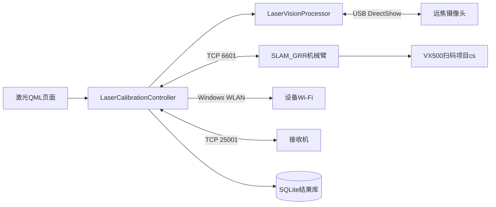
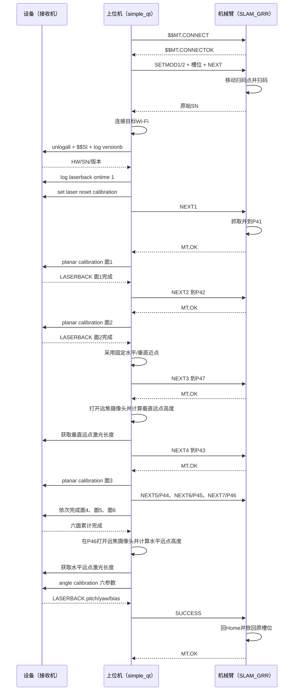
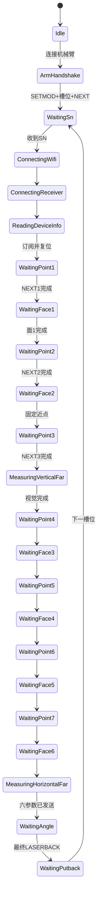

# simple_qt 与 SLAM_GRR：激光外参标定开发说明手册

> 当前源码基准，编写日期：2026-10-13。本文仅说明激光外参标定；综合说明仍见 `simple_qt与SLAM_GRR开发说明手册.md`。

## 1. 工程范围

激光标定由三个主要模块组成：

- `LaserCalibrationController`：槽位批次、机械臂、Wi-Fi、接收机协议、六面状态、结果存储。
- `LaserVisionProcessor`：单远焦 USB 摄像头和 OpenCV 高度测量。
- `SLAM_GRR/src0.lua`：激光模式扫码、抓取、NEXT1～NEXT7 和安全放回。

相关文件：

| 模块 | 文件 |
| --- | --- |
| 激光控制器 | `simple_qt/src/lasercalibrationcontroller.cpp/.h` |
| 视觉算法 | `simple_qt/src/laservisionprocessor.cpp/.h` |
| 激光界面 | `simple_qt/qml/LaserCalibrationPage.qml` |
| 页面入口/数据库窗口 | `simple_qt/qml/Main.qml` |
| 机械臂逻辑 | `SLAM_GRR/src0.lua` |
| 六面和托盘点位 | `SLAM_GRR/point.json` |

激光协议字段参考 `激光外参标定协议V2.0.0(新方案).md`，但本文以当前代码实际解析为准。

## 2. 系统架构



默认地址：机械臂 `192.168.5.1:6601`，接收机 `192.168.1.8:25001`。

## 3. 完整标定流程



时序图只保留设备、上位机和机械臂三类参与者。USB 摄像头、Wi-Fi、数据库均属于上位机内部资源，因此摄像头采集与 OpenCV 计算用 `H->>H` 表示，不再单列生命线。

## 4. 激光状态机



完整状态定义位于 `LaserCalibrationController::State`，还包括暂停、终止和异常收尾相关状态。

## 5. 机械臂 TCP 协议

### 5.1 分帧

- 上位机发送 `\r\n` 结束的请求。
- 机械臂响应由 `sendFrame()` 追加 `$*`。
- 双方都维护接收缓冲区，支持拆包和粘包。
- 缓存超过 8192 字节才作为异常清空。

### 5.2 命令与点位

| 请求 | 动作和响应 |
| --- | --- |
| `$$MT,CONNECT` | 响应 `CONNECTOK` |
| `$$MT,SETMOD1` | 选择左侧 2×5 托盘 |
| `$$MT,SETMOD2` | 选择右侧 2×5 托盘 |
| 单独数字 `1`～`10` | 保存当前槽位 |
| `$$MT,NEXT` | VX500扫码，返回原始SN |
| `$$MT,NEXT1` | 抓取并经P41，响应`MT,OK` |
| `NEXT2` | P42，面2 |
| `NEXT3` | P47，垂直远点视觉，不做面校准 |
| `NEXT4` | P43，面3 |
| `NEXT5` | P44，面4 |
| `NEXT6` | P45，面5 |
| `NEXT7` | P46，面6及水平远点视觉 |
| `$$MT,SUCCESS` | 回Home、放回，响应`MT,OK` |
| `$$MT,FAILED` | 回Home、安全放回，响应`MT,FAILED` |

面1在 NEXT1 抓取完成后的 P41 姿态执行。NEXT3 是纯视觉远点，因此 NEXT1～NEXT7 不代表七个面。

## 6. 接收机文本指令

| 指令 | 用途 |
| --- | --- |
| `unlogall thisport` | 清除当前TCP端口残留订阅 |
| `$$SI` | 查询硬件号 |
| `log versionb` | 查询版本和SN二进制报文 |
| `log laserback ontime 1` | 订阅标定结果 |
| `unlog laserback` | 取消结果订阅 |
| `set laser reset calibration` | 清除上一轮标定状态 |
| `set laser planar calibration` | 执行当前面静置/平面校准 |
| `set laser on` / `set laser off` | 激光开关 |
| `set laser survey auto` | 自动测距 |
| `log laserrangingb ontime 1/0` | 开关测距周期报文 |
| `set laser angle calibration Hn Hf Hl Vn Vf Vl` | 六参数角度校准 |

六参数顺序：

1. `Hn`：水平近点高度。
2. `Hf`：水平远点高度。
3. `Hl`：水平远点激光长度。
4. `Vn`：垂直近点高度。
5. `Vf`：垂直远点高度。
6. `Vl`：垂直远点激光长度。

当前流程只实测两组远点，近点使用固定值。

## 7. 接收机二进制报文

| 报文 | 头/长度 | 解析规则 |
| --- | --- | --- |
| 测距 | `AA 44 12 1C 89 13`，40字节 | 偏移28读取小端float米，乘1000为mm |
| versionb | `AA 44 12 1C 25`，144字节 | 偏移52、长度9读取SN |
| `$$SI` | 62字节 | 前61字节XOR校验，偏移29、长度3读取HW |

`processReceiverBuffer()` 始终先找二进制帧。只要已经发现二进制头但长度未收齐，就保留整个缓存，不让换行文本解析破坏半包。

## 8. `$LASERBACK` 协议

报文是以 `$LASERBACK` 开头的逗号分隔文本，可在末尾带 `*校验`。当前代码支持：

- 仅前 6 个状态字段的测试帧。
- 至少 21 字段的旧版帧。
- 至少 51 字段的完整帧。

### 8.1 完整帧字段

| 索引 | 内容 |
| ---: | --- |
| 0 | `$LASERBACK` |
| 1 | 时间/GPS，当前流程不使用 |
| 2 | `restBits`，六面累计完成位图 |
| 3 | `restState`，2表示当前面完成 |
| 4 | `sideState`，1表示最终角度校准完成 |
| 5 | `panelId`，面号1～6 |
| 6～41 | 六个面各6项参数，共36项 |
| 42～47 | 最终六项bias |
| 48 | pitch |
| 49 | yaw |
| 50 | errorCode |

旧版 21 字段分支：6～11 为面参数，12～17 为 bias，18 为 yaw，19 为 pitch，20 为 errorCode。新旧帧的 pitch/yaw 顺序不同。

### 8.2 六面位图

代码先执行：

```cpp
int restBits = report.restBits & 0x3f;
```

`0x3f` 即二进制 `111111`，只保留六个面的低 6 位。面 n 对应 `1 << (n-1)`；例如面4对应 `001000`。设备位图、当前已完成面和本地历史位图进行 OR，保证状态只能累计，不能因为某一帧缺位而倒退。

### 8.3 错误码

| 值 | 当前解释 |
| ---: | --- |
| 0 | 正常 |
| 1 | 外参校准失败，需要复位整个流程 |
| 2 | 当前面已经校准，检查机械臂姿态 |
| 其他 | 未知错误，记录并走失败放回 |

## 9. 视觉高度算法

当前只使用一只远焦摄像头，近焦摄像头已取消。摄像头通过 Windows DirectShow 打开，扫描索引 0～4，多只可用时选择最后一个，申请 1920×1080@30fps。

单帧处理：

1. HSV 红色双区间检测两个参考圆。
2. 红圆像素距离除以远焦参考实际长度 1060 mm，得到 `pixelPerMm`。
3. 灰度 Top-hat、连通域、颜色和绿色光晕检测激光点。
4. HSV 检测蓝色胶带，只保留激光点左右 150 px 区域。
5. 每一列取胶带连通域最上方像素，拟合胶带上边缘。
6. 沿两红圆连线方向从激光点作线，与胶带上边缘求交。
7. 计算有符号像素距离并除以 `pixelPerMm`。
8. 光点在胶带下方时距离为负。
9. 距离大于 10 px 时高度减 10 mm；小于 -10 px 时高度加 10 mm；中间不补偿。

主要识别范围：

| 项目 | 当前条件 |
| --- | --- |
| 红圆面积 | 15～800 px² |
| 红圆半径 | 2.5～25 px |
| 红圆圆度比 | 0.45～1.15 |
| 红圆间距 | 20～800 px |
| 激光连通域面积 | 4～1200 px² |
| 激光候选长宽比 | ≤2.2 |
| 高度最终范围 | 绝对值≤5000 mm |

多帧融合：先丢弃 8 帧预热；最多处理 **120 帧**；需要 4 个稳定样本。新值与当前中位数差 5～18 mm 时丢弃该帧，超过 18 mm 时清空旧样本重新积累，最后取中位数。

算法运行在 `QtConcurrent` 线程池。成功图像被编码为 PNG data URL 显示到 QML；取消任务通过 generation 令迟到结果失效，而不是强制杀死 OpenCV 线程。

## 10. 当前测量参数

| 参数 | 当前值 | 来源 |
| --- | ---: | --- |
| 水平近点 | 620 mm | QML只读输入并传给控制器 |
| 垂直近点 | 520 mm | 控制器硬编码 |
| 远焦参考长度 | 1060 mm | 视觉算法常量 |
| 近焦参考长度 | 566 mm | 保留但正式流程未使用 |
| 稳定样本 | 4帧 | `kRequiredSamples` |
| 最大检查 | 120帧 | `kMaximumFrames` |

最终六参数构造：

```text
水平 = [620, 水平远点视觉高度, 水平远点激光测距]
垂直 = [520, 垂直远点视觉高度, 垂直远点激光测距]
```

视觉高度允许为负；两个激光测距必须是有限正数。修改固定近点或参考长度后，必须用已知尺寸重新验证最终 pitch/yaw。

## 11. 结果存储

- SQLite：`QStandardPaths::AppDataLocation/laser_calibration.db`。
- 表：`laser_results`。
- 字段包括时间、托盘、槽位、SN、HW、版本、距离、高度、pitch、yaw、成功、错误、bias。
- CSV：用户文档目录的 `laser_results_时间.csv`。
- 每个槽位只记录一次结果，防止错误回调重复插入。

## 12. 超时、失败与安全放回

| 阶段 | 当前限制 |
| --- | ---: |
| 机械臂点位 | 90 s |
| Wi-Fi检查 | 35次 |
| 接收机连接 | 20次 |
| 单面校准 | 60 s |
| 最终角度结果 | 20 s |
| 单次视觉 | 45 s |

任一步失败：

1. 取消当前视觉结果。
2. `set laser off`。
3. `log laserrangingb ontime 0`。
4. `unlog laserback`。
5. 向机械臂发送 `$$MT,FAILED`。
6. 机械臂先回 Home，再放回原槽位。
7. 记录失败并继续下一槽位。

如果机械臂连接已经中断，则停止整个批次，不假定设备已经放回，也不发送下一槽位命令。

## 13. 机械臂初始化与托盘

激光托盘是左右各 2×5：

- 左夹取网格：P21～P24。
- 左扫码网格：P27～P30。
- 右扫码网格：P31～P34。
- 右夹取网格：P35～P38。

启动时机械臂先回 P41，然后垂直下降 175 mm，在低位初始化并打开夹爪，再恢复高度。抓放时使用槽位上方 150 mm 接近点，下降和离开均采用垂直路径。

夹爪 Modbus RTU 参数：站号9、115200、8E1，闭合65280、张开0、力65535。

## 14. 构建与部署

依赖：Qt 5.14.2 MinGW 64-bit、Qt Quick/QML、Qt Network、Qt SQL、Qt Concurrent、OpenCV 3.4.5。

```powershell
D:\Qt\Qt5.14.2\5.14.2\mingw73_64\bin\qmake.exe simple_qt.pro CONFIG+=debug
D:\Qt\Qt5.14.2\Tools\mingw730_64\bin\mingw32-make.exe -j4
```

机械臂端必须部署完整 `SLAM_GRR` 工程，包括 `src0.lua` 和 `point.json`。修改六面点位后必须低速空载逐点验证。

## 15. 关键函数

| 文件 | 函数 | 作用 |
| --- | --- | --- |
| `lasercalibrationcontroller.cpp` | `beginCurrentSlot()` | SETMOD、槽位、NEXT扫码 |
| 同上 | `processReceiverBuffer()` | 二进制和文本拆包 |
| 同上 | `parseLaserBack()` / `handleLaserBack()` | 六面和最终结果解析 |
| 同上 | `requestPlanarCalibration()` | 单面校准及诊断 |
| 同上 | `startVisionMeasurement()` | 异步提交视觉任务 |
| 同上 | `calculateAngleInputs()` | 构造六参数 |
| 同上 | `failCurrentSlot()` | 失败安全收尾 |
| `laservisionprocessor.cpp` | `processFrame()` | 单帧完整算法 |
| 同上 | `runMeasurement()` | 多帧融合 |
| `SLAM_GRR/src0.lua` | `runLaserPoint()` | NEXT1～NEXT7映射 |
| 同上 | `putBackCurrentDevice()` | 原槽位放回 |

## 16. 排障要点

| 现象 | 优先检查 |
| --- | --- |
| 扫码无响应 | SETMOD、槽位、NEXT是否按顺序发送，SN是否以`$*`结束 |
| 接收机信息超时 | 25001端口、二进制帧长度、`$$SI` CRC |
| 标定面超时 | planar命令是否写出、5秒诊断收包字节、有效LASERBACK数量 |
| 图已画线但流程失败 | 是否收齐4个稳定帧、是否同时收到正数测距 |
| height经常失败 | 两红圆、激光点、蓝胶带上边缘三个阶段的失败汇总 |
| pitch/yaw没有更新 | 六参数命令顺序、sideState是否为1、完整帧字段数量 |
| 失败后不放回 | 机械臂TCP是否仍连接、是否收到FAILED、当前是否MANUAL_RECOVERY |

