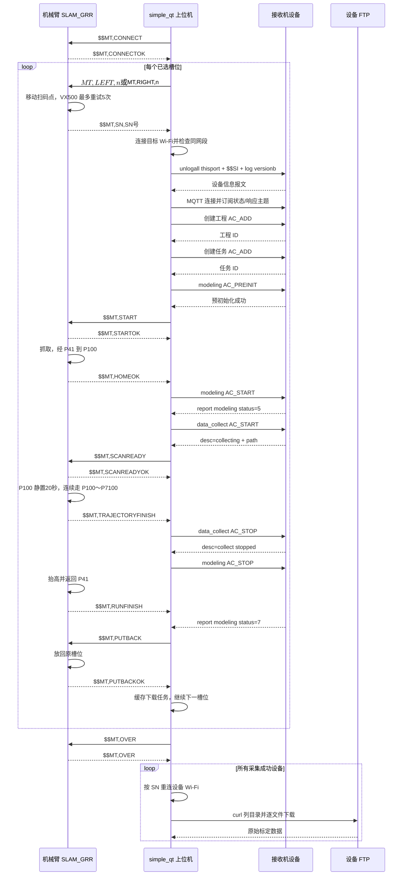
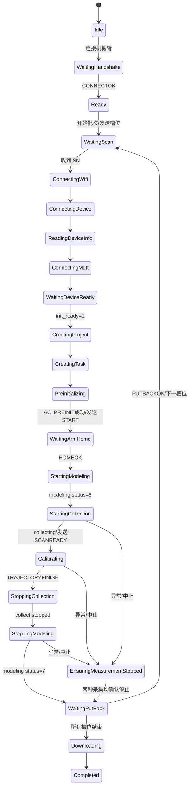
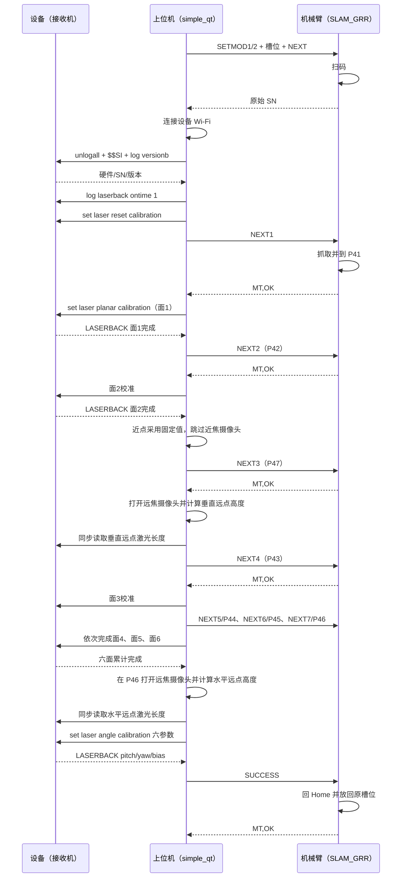

# simple_qt 与 SLAM_GRR 开发说明手册

## 1. 文档范围与基准

本文档说明下列两个配套工程的架构、通信协议、状态机、标定流程、数据输出、异常恢复和部署方法：

- `simple_qt`：Windows/Qt 上位机，包含 SLAM 标定和激光外参标定两套业务。
- `SLAM_GRR`：Dobot CR10V-IS 机械臂 Lua 工程，同时支持 SLAM 轨迹和激光六面轨迹。

| 模块 | 当前文件 | 主要职责 |
| --- | --- | --- |
| 程序入口 | `simple_qt/src/main.cpp` | 创建两个控制器并注入 QML |
| SLAM 控制器 | `simple_qt/src/tcpcontroller.cpp/.h` | 机械臂、Wi-Fi、设备 TCP、MQTT、FTP、批次状态机 |
| 激光控制器 | `simple_qt/src/lasercalibrationcontroller.cpp/.h` | 激光批次、六面校准、视觉测量、结果存储 |
| 激光视觉 | `simple_qt/src/laservisionprocessor.cpp/.h` | OpenCV 单远焦摄像头算法 |
| SLAM 页面 | `simple_qt/qml/Main.qml` | 2×4 槽位、状态、日志与下载结果 |
| 激光页面 | `simple_qt/qml/LaserCalibrationPage.qml` | 2×5 槽位、测量值、六面状态、数据库 |
| 机械臂逻辑 | `SLAM_GRR/src0.lua` | TCP Server、扫码、抓放、SLAM/激光轨迹 |
| 机械臂点位 | `SLAM_GRR/point.json` | 托盘角点、Home、六面姿态、P100～P7100 |

## 2. 系统架构

两个上位机控制器共享同一机械臂地址，但界面只允许选择其中一种标定模式运行。机械臂端通过 `currentMode` 在 `SLAM` 和 `LASER` 两套协议之间切换。

### 2.1 默认网络参数

| 对象 | 地址/端口 | 角色 |
| --- | --- | --- |
| 机械臂 | `192.168.5.1:6601` | TCP Server；上位机为 Client |
| 设备信息/激光协议 | `192.168.1.8:25001` | 设备为 TCP Server |
| MQTT | `192.168.1.8:1883`，失败后尝试 `26001` | 无认证本地 MQTT |
| FTP | `ftp://192.168.1.8:21/` | 用户名/密码均为 `ftpuser` |

上位机按扫码 SN 搜索并连接设备热点。连接成功后还会检查本机是否已经通过 DHCP/路由切换到接收机网段，不能只凭 SSID 判断设备网络可用。

## 3. 公共机械臂 TCP 协议

### 3.1 分帧与粘包处理

- 上位机发送命令时追加 `\r\n`。
- 机械臂 `sendFrame()` 在响应末尾追加 `$*`。
- 两端都维护持久接收缓冲区，允许一次 `TCPRead/readyRead` 得到半包或多个包。
- 上位机按最先出现的 `\r\n`、`\n` 或 `$*` 拆帧；机械臂按最先出现的 `\n` 或 `$*` 拆帧。
- 不完整尾包保留到下一次接收；缓存超过 8192 字节才作为异常清空。

### 3.2 公共握手

| 方向 | 内容 | 含义 |
| --- | --- | --- |
| 上位机 → 机械臂 | `$$MT,CONNECT` | 应用层连接探测 |
| 机械臂 → 上位机 | `$$MT,CONNECTOK$*` | 机械臂程序已就绪 |

SLAM 上位机每 3 秒重试一次，主动重试最多 3 次；激光控制器以 3 秒周期保持握手。TCP 连接成功不等于业务握手成功。

## 4. SLAM 标定

### 4.1 总体时序图



这里的 `HOMEOK` 是兼容旧协议保留的名字，当前实际含义是“设备已被夹持且 P100 已稳定到位”，并不表示仍停在 P41/Home。

### 4.2 SLAM 上位机状态机



完整枚举还包括 `Recovering`、`Aborted` 等收尾状态，定义在 `TcpController::FlowState`。

### 4.3 SLAM 机械臂命令表

| 上位机请求 | 机械臂响应 | 前置条件/动作 |
| --- | --- | --- |
| `$$MT,LEFT,n` | `$$MT,SN,<sn>` | 左 2×4 托盘槽位 1～8，移动扫码点并扫码 |
| `$$MT,RIGHT,n` | `$$MT,SN,<sn>` | 右 2×4 托盘槽位 1～8 |
| `$$MT,START` | `STARTOK`，到 P100 后 `HOMEOK` | 必须已经扫码成功且夹爪就绪 |
| `$$MT,SCANREADY` | `SCANREADYOK` | 只有 P100、modeling=5、collecting 同时成立才发送 |
| 无 | `TRAJECTORYFINISH` | P7100 实测连续 3 次进入容差后发送 |
| 无 | `RUNFINISH` | 安全抬高并回 P41 后发送 |
| `$$MT,PUTBACK` | `PUTBACKOK` | 放回原托盘、原槽位 |
| `$$MT,FAILED` | `PUTBACKOK` 或 `FAILEDOK` | 有设备则放回；无设备则确认异常 |
| `$$MT,OVER` | `OVER` | 批次结束，必要时先放回并回 Home |

主要失败响应：

- `FAILED,SCAN,<side>,<slot>`：扫码 5 次仍失败。
- `FAILED,SLOT,<n>`：槽位不在 1～8。
- `FAILED,BUSY`：仍夹着上一台设备。
- `FAILED,GRIPPER`：夹爪未初始化成功。
- `FAILED,STATE,START/SCANREADY`：命令和机械臂状态不匹配。
- `FAILED,MOTION,P100_START/TRAJECTORY_END/EXIT/HOME`：实际位姿未确认，禁止自动放回，必须人工排查。

### 4.4 SLAM 机械臂点位与运动

| 点位 | 当前用途 |
| --- | --- |
| P21～P24 | 左托盘夹取网格四角 |
| P27～P30 | 左托盘扫码网格四角 |
| P31～P34 | 右托盘扫码网格四角 |
| P35～P38 | 右托盘夹取网格四角 |
| P41 | GRR20 Home/安全过渡点 |
| P50 | 低位回 Home 时临时写入的安全抬升点 |
| P100 | SLAM 采集起点；在此启动扫描、采集并静置 20 秒 |
| P200～P7100 | 从原 SLAM_test 的 P2～P71 移植并乘 100 编号的连续轨迹 |
| P7100 | 采集终点；实测到位后立即通知上位机结束采集 |

轨迹参数为 `VelJ(5)`、`AccJ(10)`、`AccL(10)`，P100 静置完成后启用 `CP(100)` 并连续提交所有 `MovJ`，中间不插入 `Wait`。到 P7100 后恢复 `CP(0)`，沿用户坐标 Z 方向抬高 400 mm，再以 `VelJ(10)` 回 P41。位置容差为 8 mm，姿态容差为 5°，连续 3 次满足才认定到位。

抓取时从扫码点先直线上升 150 mm，再移动到夹取点上方 150 mm，低速垂直下降、夹紧、垂直抬升。放回使用相反路径。

### 4.5 设备信息 TCP 协议

上位机连接 `192.168.1.8:25001` 后一次发送：

```text
unlogall thisport\r\n
$$SI\r\n
log versionb\r\n
```

当前解析规则：

- `$$SI`：固定 62 字节，前 61 字节逐字节 XOR，最后一字节为 CRC；硬件号位于偏移 29、长度 3。
- 文本行：兼容 JSON `{sn,hw,version}` 和 `SN/HW/VERSION` 键值形式。
- SLAM 流程只要求硬件号不为空即可进入 MQTT；SN 优先使用机械臂扫码结果。

### 4.6 MQTT/OpenAPI 协议

#### 订阅主题（设备响应）

前五个主题返回 protobuf 二进制 message，最后一个 `data_collect` 返回 UTF-8 JSON。protobuf 不能当作字符串直接打印，必须按字段号解析。

| 设备返回主题 | QoS | Payload/message | 当前上位机读取内容 |
| --- | ---: | --- | --- |
| `slam_app/report/device_status` | 0 | `DeviceStatusReport` | 字段4 `init_ready`；字段5 `Error` |
| `slam_app/response/project` | 1 | `ProjectResponse` | 字段2 `Error`；字段3 `action`；字段4 `ProjectInfo` |
| `slam_app/response/task` | 1 | `TaskResponse` | 字段2 `Error`；字段3任务ID；字段4 `action` |
| `slam_app/response/modeling` | 1 | `ModelingResponse` | 字段2 `Error`；字段3 `action` |
| `slam_app/report/modeling` | 0 | `ModelingReport` | 字段2进度；字段4扫描状态；字段5扫描统计；字段6 `Error` |
| `slam_app/response/data_collect` | 1 | JSON对象 | `error`、`desc`、`path` |

公共 protobuf 子消息：

```protobuf
message Header {
    uint32 seq = 1;
    sint64 timestamp = 2;
    string session_id = 3;
}

message Error {
    uint32 code = 1;
    string desc = 2;
}
```

##### `slam_app/report/device_status`

```protobuf
message DeviceStatusReport {
    Header header = 1;
    sint32 project_id = 2;
    string project_name = 3;
    bool init_ready = 4;
    Error error = 5;
    float cpu_temperature = 6;
    float cpu_usage = 7;
}
```

示例：

```text
DeviceStatusReport {
  init_ready: true
  error: { code: 0, desc: "" }
  cpu_temperature: 52.3
  cpu_usage: 126.0
}
```

当前上位机只使用 `init_ready` 和 `error`；`init_ready=true` 后才创建工程。

##### `slam_app/response/project`

```protobuf
message ProjectResponse {
    Header header = 1;
    Error error = 2;
    Application.ActionCmd action = 3;
    ProjectInfo project = 4;
}
```

```text
ProjectResponse {
  error: { code: 0, desc: "" }
  action: AC_ADD
  project: { id: 123, name: "CAL_20261013_120000" }
}
```

上位机从字段4的 `ProjectInfo` 子字段1取得工程ID，工程ID必须大于0。

##### `slam_app/response/task`

```protobuf
message TaskResponse {
    Header header = 1;
    Error error = 2;
    optional sint32 id = 3;
    Application.ActionCmd action = 4;
    ProjectInfo project = 5;
}
```

```text
TaskResponse {
  error: { code: 0, desc: "" }
  id: 456
  action: AC_ADD
}
```

上位机读取字段3作为任务ID，随后进入 `AC_PREINIT`。

##### `slam_app/response/modeling`

```protobuf
message ModelingResponse {
    Header header = 1;
    Error error = 2;
    Application.ActionCmd action = 3;
}
```

设备会根据请求返回 `action: AC_PREINIT`、`AC_START` 或 `AC_STOP`。该 message 只表示命令被接受或拒绝，不表示传感器已经完成启动；真实扫描启动以 `slam_app/report/modeling` 的字段4等于5为准。

##### `slam_app/report/modeling`

```protobuf
message ModelingReport {
    message ScanStatus {
        uint32 status_code = 1;
        float move_distance = 2;
        float move_speed = 3;
        sint64 scan_time = 4;
        sint64 scan_points = 5;
    }

    Header header = 1;
    sint32 pgo_progress = 2;
    sint64 scaler = 3;
    ModelingStatus modeling_status = 4;
    ScanStatus scan_status = 5;
    Error error = 6;
}
```

```text
ModelingReport {
  pgo_progress: 0
  modeling_status: EC_ScanScanning
  scan_status: {
    status_code: 0
    move_distance: 1.25
    move_speed: 0.03
    scan_time: 35
    scan_points: 120000
  }
  error: { code: 0, desc: "" }
}
```

##### `slam_app/response/data_collect`

该主题返回 JSON，而不是 protobuf。

```json
{"error":0,"desc":"collecting","path":"/mnt/mmc/mmcblk0/collect/20261013_120000"}
```

停止成功时 `desc` 为 `collect stopped`。`error` 含义：0成功、1不支持、2当前状态不允许、3文件或目录错误、4系统初始化错误；`path` 是设备端采集目录，后续映射为FTP下载路径。

#### 发布主题与负载

| 主题 | 格式 | 当前负载关键字段 |
| --- | --- | --- |
| `app_slam/request/project` | protobuf | 1=Header，2=AC_ADD(7)，4=工程名，5=`SLAM calibration` |
| `app_slam/request/task` | protobuf | 1=Header，2=AC_ADD(7)，3=工程ID，5=任务名，6=`simple_qt` |
| `app_slam/request/modeling` | protobuf | 1=Header，2=动作，3=任务ID，4=RM_RECORD_CALC(2)，5=MT_HAND(0)，6=工程ID，7=不启用Ntrip/RTK(0) |
| `app_slam/request/data_collect` | JSON | `{"action":"AC_START"}` 或 `{"action":"AC_STOP"}` |

modeling 动作值：`AC_START=1`、`AC_STOP=2`、`AC_PREINIT=9`。工程和任务创建使用 `AC_ADD=7`。

扫描状态 `slam_app/report/modeling` 的字段 4：

| 状态 | 当前上位机解释 |
| --- | --- |
| 1 | 扫描前自检 |
| 2 | 扫描模块就绪，等待静止初始化 |
| 3 | 打开传感器 |
| 4 | 初始化 SLAM 算法 |
| 5 | `EC_ScanScanning`，雷达、相机和 SLAM 正式运行 |
| 6 | 停止后保存扫描工程 |
| 7 | 保存完成并结束 |
| 8、9 | 异常退出 |

`AC_PREINIT` 在设备仍位于托盘时执行，用任务 ID、母工程 ID、记录模式和建模类型预先初始化扫描模块。它成功后才允许机械臂抓取，避免抓起设备后才发现工程、任务或算法无法初始化。

原始采集响应是 JSON，关注 `error`、`desc`、`path`：

```json
{"error":0,"desc":"collecting","path":"/data/collect/..."}
```

- `collecting` 或 `already active`：记录已经开始，可释放机械臂轨迹。
- `collect stopped`：记录已封口，随后发送 modeling `AC_STOP`。
- `error=3` 且说明包含 `collect dir`：目录创建失败。上位机会先发 `AC_STOP`，静置 5 秒，最多恢复 3 次。
- `error=2` 且没有活动会话：恢复流程中按“已清理”处理。

真实扫描和原始记录作用不同：modeling `AC_START` 打开传感器并运行 SLAM；data_collect `AC_START` 把原始数据写入标定目录。当前流程必须两者同时就绪才执行轨迹。

#### SLAM 设备相关指令汇总

SLAM 标定先通过 `192.168.1.8:25001` 查询设备信息，再通过 MQTT 控制扫描和原始数据记录。MQTT 动作是协议负载，不是直接发送到 25001 端口的文本行。

| 指令或动作 | 通信方式/主题 | 用途 |
| --- | --- | --- |
| `unlogall thisport` | TCP `192.168.1.8:25001` | 清除当前 TCP 连接遗留的周期报文订阅 |
| `$$SI` | TCP `192.168.1.8:25001` | 查询硬件号；解析 62 字节响应并进行 XOR CRC 校验 |
| `log versionb` | TCP `192.168.1.8:25001` | 查询设备 SN/版本相关信息 |
| `AC_ADD`（7） | MQTT `app_slam/request/project` | 创建扫描工程并取得工程 ID |
| `AC_ADD`（7） | MQTT `app_slam/request/task` | 创建扫描任务并取得任务 ID |
| `AC_PREINIT`（9） | MQTT `app_slam/request/modeling` | 预初始化扫描模块；成功后才允许机械臂抓取 |
| `AC_START`（1） | MQTT `app_slam/request/modeling` | 启动雷达、相机等传感器和 SLAM，等待状态 5 |
| `AC_STOP`（2） | MQTT `app_slam/request/modeling` | 停止真实扫描并保存工程，等待状态 7 |
| `AC_START` | MQTT `app_slam/request/data_collect`，JSON | 开始把原始数据写入采集目录，等待 `collecting` 和 `path` |
| `AC_STOP` | MQTT `app_slam/request/data_collect`，JSON | 停止并封口原始采集目录，等待 `collect stopped` |

`data_collect` 请求示例：

```json
{"action":"AC_START"}
```

```json
{"action":"AC_STOP"}
```

关键设备返回：`init_ready=1` 表示允许创建工程；modeling 状态 5 表示真实扫描已经启动；状态 6 表示保存中；状态 7 表示保存完成；状态 8/9 表示异常退出。

### 4.7 FTP 与结果输出

每台设备完成采集后只缓存 `{SN, Wi-Fi, collectPath}`，机械臂立即放回并处理下一台；全部槽位结束后统一下载，下载不会阻塞机械臂批处理。

- 设备目录：从响应 `path` 中截取 `/collect/...` 映射到 FTP。
- 本地目录：`%USERPROFILE%/Downloads/SLAM_calibration/<采集目录名>/`。
- 使用系统 `curl`，被动 FTP、失败重试 5 次、支持断点续传，单文件最大 1800 秒。
- 结果 CSV：`%USERPROFILE%/Documents/SLAM_calibration/results.csv`，UTF-8 BOM。
- CSV 字段：`time,tray,slot,sn,hardware,version,result,data_path,error`。

### 4.8 SLAM 超时与异常恢复

| 步骤 | 超时 |
| --- | ---: |
| 扫码 | 60 s |
| Wi-Fi | 45 s |
| 设备 TCP | 15 s |
| 设备信息 | 20 s |
| MQTT | 25 s |
| init_ready | 90 s |
| 创建工程/任务 | 各 20 s |
| AC_PREINIT | 60 s |
| modeling 启动 | 120 s |
| data_collect 启停 | 20 s / 30 s |
| 到 P100 | 120 s |
| SLAM 轨迹 | 5 min |
| modeling 停止保存 | 5 min |
| 放回 | 120 s |

只要曾经发送过任一种 `AC_START`，异常时就进入兜底停止：保持当前槽位，重连 Wi-Fi/MQTT，每 8 秒重发停止，直到 modeling 为 7/8/9 且原始采集明确停止；最多 6 次。确认停止后才允许放回和处理下一槽位。

运动到位失败属于安全例外：停止设备测量但不自动移动机械臂，不继续下一槽位，要求人工恢复，避免未知姿态下碰撞。

## 5. 激光外参标定

### 5.1 总体时序图



时序图只保留设备、上位机和机械臂三类参与者。USB 摄像头、Wi-Fi、数据库均视为上位机内部资源，因此摄像头采集与 OpenCV 计算以 `H->>H` 表示。

### 5.2 激光机械臂协议与点位

| 上位机请求 | 机械臂动作/响应 |
| --- | --- |
| `$$MT,SETMOD1` | 选择左 2×5 托盘 |
| `$$MT,SETMOD2` | 选择右 2×5 托盘 |
| 单独数字 `1`～`10` | 保存槽位 |
| `$$MT,NEXT` | 在对应扫码网格扫码，返回原始 SN |
| `$$MT,NEXT1` | 抓取并经 P41，返回 `$$MT,OK` |
| `NEXT2` | P42，面2姿态 |
| `NEXT3` | P47，垂直远点视觉姿态，不做面校准 |
| `NEXT4` | P43，面3姿态 |
| `NEXT5` | P44，面4姿态 |
| `NEXT6` | P45，面5姿态 |
| `NEXT7` | P46，面6及水平远点视觉姿态 |
| `$$MT,SUCCESS` | 先回 Home，再放回，响应 `MT,OK` |
| `$$MT,FAILED` | 从当前姿态先回 Home，再放回，响应 `MT,FAILED` |

面1位于 NEXT1 抓取结束后的 P41；因此“七个 NEXT 点”中包含一次夹取、一个纯视觉远点和六个面姿态，并不是七个校准面。

### 5.3 接收机文本指令

| 指令 | 当前用途 |
| --- | --- |
| `unlogall thisport` | 清除当前 TCP 端口旧订阅 |
| `$$SI` | 查询硬件号 |
| `log versionb` | 查询 144 字节版本/SN 报文 |
| `log laserback ontime 1` | 周期订阅激光标定结果 |
| `unlog laserback` | 取消结果订阅 |
| `set laser reset calibration` | 清空上一轮外参状态 |
| `set laser planar calibration` | 对当前机械姿态执行一面静置/平面校准 |
| `set laser on/off` | 打开/关闭激光 |
| `set laser survey auto` | 自动测距模式 |
| `log laserrangingb ontime 1/0` | 开启/关闭测距二进制报文 |
| `set laser angle calibration Hn Hf Hl Vn Vf Vl` | 用六参数计算最终 pitch/yaw |

六参数顺序固定为：水平近点高度、水平远点高度、水平远点激光长度、垂直近点高度、垂直远点高度、垂直远点激光长度。

### 5.4 接收机二进制报文

| 报文 | 识别/长度 | 当前解析 |
| --- | --- | --- |
| 测距 | 头 `AA 44 12 1C 89 13`，40 字节 | 偏移 28 读取小端 `float` 米，乘 1000 得 mm |
| versionb | 头 `AA 44 12 1C 25`，144 字节 | 偏移 52、长度 9 读取 SN |
| `$$SI` | 包含 ASCII `$$SI`，62 字节 | XOR CRC；偏移 29、长度 3 读取 HW |

解析器先提取完整二进制帧，再解析换行文本；看到二进制头但数据未收齐时保留缓存，避免拆包被文本解析误删。

### 5.5 `$LASERBACK` 报文

文本帧以 `$LASERBACK` 开头、逗号分隔，可在末尾带 `*校验`。当前解析支持三种长度：仅前 6 个状态字段、旧版至少 21 字段、完整至少 51 字段。

完整帧按从 0 开始的索引解释：

| 索引 | 内容 |
| ---: | --- |
| 0 | `$LASERBACK` |
| 1 | GPS/时间字段，当前不参与流程 |
| 2 | `restBits`，六面累计完成位图，仅保留低 6 位 `& 0x3f` |
| 3 | `restState`，当前面为 2 表示静置/面校准完成 |
| 4 | `sideState`，最终为 1 表示整机角度校准完成 |
| 5 | `panelId`，当前面 1～6；异常值回退到状态机当前面 |
| 6～41 | 六个面各 6 个参数，共 36 项 |
| 42～47 | 最终 6 项 bias |
| 48 | pitch |
| 49 | yaw |
| 50 | errorCode |

旧版 21 字段兼容分支使用 6～11 为当前面参数、12～17 为 bias、18 为 yaw、19 为 pitch、20 为 errorCode。注意新旧版 pitch/yaw 顺序不同，这是当前兼容代码的明确行为。

`restBits` 的面 n 对应 `1 << (n-1)`；例如面4完成即置位 `1 << 3 = 0b001000`。代码还把设备位图、当前完成面和本地历史位图做 OR，保证累计状态只增不减。

错误码当前解释：0 正常；1 外参校准失败、需复位流程；2 当前面已经校准、需检查姿态；其他值显示未知错误并放回设备。

### 5.6 单摄像头视觉算法

当前仅使用一只远焦 USB 摄像头，DirectShow 索引扫描范围 0～4，多只可用时取最后一个索引；请求分辨率 1920×1080、30 fps。近焦请求会被拒绝，近点采用固定值。

单帧算法：

1. HSV 两段红色阈值识别两个参考圆，面积 15～800 px²、半径 2.5～25 px、圆度比 0.45～1.15。
2. 两圆像素距离除以已知远焦参考长度 1060 mm，得到 `pixelPerMm`。
3. 灰度 Top-hat 和连通域检测绿色/过曝白色激光点，远焦额外检查绿色光晕。
4. HSV 识别蓝色胶带，在激光点左右 150 px 范围内选择最佳细长连通域。
5. 每列只取该连通域最上方像素，拟合蓝胶带上边缘。
6. 沿两个红圆的方向从激光点作线，与胶带上边缘求交。
7. `height = signedPixelDistance / pixelPerMm`。激光点在胶带下方时距离为负。
8. 当前统一补偿：像素距离 `>10` 时高度减 10 mm；`<-10` 时高度加 10 mm；中间区间不补偿。

一次任务先丢弃 8 帧预热，然后最多检查 **120 帧**，需要得到 4 个稳定样本。与当前中位数相差 5～18 mm 的帧被拒绝，超过 18 mm 会清空已积累样本重新开始，最终取 4 帧中位数。图像处理运行于 `QtConcurrent` 线程池，不阻塞 QML 主线程。

当前源码固定/可配置参数：

| 参数 | 当前值 | 位置 |
| --- | ---: | --- |
| 水平近点 | 620 mm | `LaserCalibrationPage.qml` 只读字段，传给控制器 |
| 垂直近点 | 520 mm | `LaserCalibrationController` 硬编码 |
| 远焦红圆实际距离 | 1060 mm | `laservisionprocessor.cpp` |
| 近焦红圆实际距离 | 566 mm | 保留常量，当前正式流程不使用 |
| 最大处理帧数 | 120 | `kMaximumFrames` |
| 稳定样本数 | 4 | `kRequiredSamples` |

### 5.7 激光结果存储

- SQLite：`QStandardPaths::AppDataLocation/laser_calibration.db`。
- 表：`laser_results`。
- 保存内容：时间、托盘、槽位、SN、HW、版本、距离、高度、pitch、yaw、成功状态、错误说明、bias。
- 导出 CSV：用户文档目录下 `laser_results_时间.csv`。

激光主要超时：机械臂点位 90 s；Wi-Fi 检查 35 次；接收机连接 20 次；单面 60 s；角度结果 20 s；视觉 45 s。任一步失败都会关闭激光、停止测距和 `$LASERBACK` 订阅，并向机械臂发送 `FAILED` 安全放回，然后继续下一槽位；机械臂断线时停止整个批次。

## 6. 机械臂初始化与安全约束

`SLAM_GRR/src0.lua` 启动顺序：

1. 设置 `VelJ(30)`、`VelL(20)`、`AccJ/AccL(50)`。
2. 回 P41/Home；当前 Z 低于 500 mm 时先借 P50 抬到 530 mm。
3. 从 P41 垂直下降 175 mm，在低位初始化并张开 Modbus 夹爪，防止异常重启时高处掉件。
4. 恢复高度，建立 SLAM 2×4 和激光 2×5 的左右扫码/夹取网格。
5. 在 `192.168.5.1:6601` 启动 TCP Server，断线后销毁旧 socket 并自动重新监听。

夹爪 Modbus RTU 参数为站号 9、115200、偶校验、8 数据位、1 停止位（8E1）；闭合位置 65280，张开位置 0，力参数 65535。

首次上机或点位变更后必须空载、低速、急停可用地验证：左右托盘四角、槽位顺序、扫码高度、抓取高度、150 mm 垂直抬升、P41→P100、完整 P100～P7100、P7100 抬高 400 mm 和六面姿态。软件保护不能替代机械限位、碰撞检测和现场安全评估。

## 7. 界面状态约定

SLAM 槽位：蓝色待处理、橙色处理中、紫色等待统一下载、天蓝色下载中、绿色成功、红色失败。激光槽位使用同类状态色，面 1～6 的绿色指示仅表示相应 `restBits` 已完成。

QML 通过 `tcpController` 和 `laserController` 两个上下文对象调用后端。切换模式前必须结束当前任务，避免两个控制器同时连接同一机械臂。

## 8. 构建、调试与部署

### 8.1 simple_qt

依赖：Windows 10/11、Qt 5.14.2 MinGW 64-bit、Qt MQTT、Qt SQL、Qt Concurrent、OpenCV 3.4.5、系统 curl。

```powershell
D:\Qt\Qt5.14.2\5.14.2\mingw73_64\bin\qmake.exe simple_qt.pro CONFIG+=debug
D:\Qt\Qt5.14.2\Tools\mingw730_64\bin\mingw32-make.exe -j4
```

VS Code 按 F5 使用 `.vscode/launch.json` 的 `Debug simple_qt (GDB)`，先执行 `.vscode/build-debug.ps1`，目标程序为 `build-qmake-debug/debug/simple_qt.exe`。OpenCV DLL 由 `.pro` 的 post-link 自动复制。

### 8.2 SLAM_GRR

工程文件：`prj.json` 指定入口 `src0.lua`、全局变量 `global.lua`、示教点 `point.json`。在 DobotStudio Pro 中打开完整工程目录并下载/运行；不要只复制 `src0.lua`，否则 P21～P7100 点位不会同步。

部署前备份控制器现有工程和点位。修改 `point.json` 后重新下载工程，并先点动验证关键点，禁止直接满速跑批次。

## 9. 日志与排障定位

| 现象 | 优先检查 |
| --- | --- |
| TCP 已连但按钮无动作 | 是否收到 `CONNECTOK`，机械臂 `src0.lua` 是否正在运行 |
| 扫码后停住 | 机械臂是否发出完整 `$*` 帧；上位机是否进入 WaitingScan；VX500 `cs` 项目结果 |
| 抓起后停在 P100 | MQTT modeling 是否到 status=5；data_collect 是否返回 `collecting`；只有两者成立才发 SCANREADY |
| 轨迹结束仍采集 | 是否收到 `TRAJECTORYFINISH`；上位机是否发送 data_collect AC_STOP |
| `failed to create collect dir` | 设备空间、挂载、只读状态、残留采集会话；查看 3 次自动恢复日志 |
| 激光面超时 | `set laser planar calibration` 是否写出；5 秒诊断中的收包字节、有效 LASERBACK、缓存长度 |
| 视觉有标注图但流程失败 | 是否收齐 4 个稳定帧；同时检查激光测距是否为正值 |
| height 算不出 | 两红圆、绿色激光点、蓝胶带上边缘任一环节失败；查看视觉诊断汇总 |
| FTP 失败 | collectPath 是否存在、设备 FTP 是否可达、curl 是否在 PATH、目录是否为空 |

机械臂日志带 `[GRR20]` 前缀；上位机通信和状态日志显示在当前模式页面。视觉详细日志由 `LaserVisionProcessor::diagnosticMessage` 转发到激光页面日志。

## 10. 修改协议时的联动清单

1. 修改机械臂命令时，同时更新 `SLAM_GRR/src0.lua::handleCommand/processTcpPayload` 与上位机对应解析函数。
2. 新增 TCP 响应必须带 `$*`；新增上位机请求必须带换行。
3. 改 MQTT protobuf 字段前，先对照设备固件 OpenAPI 版本，不要只修改数值常量。
4. 改 SLAM 终点时，同步修改轨迹、到位确认目标和 `TRAJECTORYFINISH` 时机。
5. 改激光 NEXT 点时，同步修改六面编号、视觉测量位置和机械臂点位映射。
6. 改固定近点、参考圆实际长度或 ±10 mm 补偿后，必须用已知尺寸样件重新验证 pitch/yaw。
7. 任何失败分支都要保证：先停止设备测量，再判断是否能安全放回，最后才进入下一槽位。

## 11. 当前实现特别说明

- 当前 `simple_qt` 的 SLAM 数据不是每台立刻 FTP 下载，而是每台采集后立即放回、整批结束后统一下载。
- 当前 SLAM 数据采集在 P100 才开始，P41/Home 不静置、不启动测量；P7100 到位即结束采集，回 Home 轨迹不写入标定数据。
- 当前激光方案已经取消近焦摄像头，垂直近点和水平近点使用固定值，只实测垂直远点与水平远点的高度和激光长度。
- 当前视觉源码实际为最多 120 帧，而不是历史版本中的 300 帧。
- 当前固定值实际为水平 620 mm、垂直 520 mm；若现场要求 615/511 或其他数值，应作为一次独立标定参数变更，同时修改界面显示、控制器计算和本文档。

## 12. 关键函数索引

### 12.1 simple_qt SLAM

| 函数 | 作用 |
| --- | --- |
| `TcpController::startTask()` | 校验槽位并创建本批任务队列 |
| `startNextSlot()` | 清理上一台上下文并发送下一槽位扫码命令 |
| `processArmBuffer()` / `handleArmCommand()` | 机械臂拆包及协议分发 |
| `handleScannedSn()` | 保存 SN，开始 Wi-Fi 阶段 |
| `connectDeviceTcp()` / `processDeviceBuffer()` | 读取接收机硬件和版本信息 |
| `connectMqtt()` / `subscribeMqttTopics()` | 建立 MQTT 并订阅所有主题 |
| `publishProjectCreate()` / `publishTaskCreate()` | 创建 SLAM 工程与任务 |
| `publishModelingPreinit()` | 发送 AC_PREINIT |
| `tryStartModelingWhenArmHome()` | HOMEOK 后启动真实扫描 |
| `publishCollectAction()` | 启停原始数据落盘 |
| `handleModelingReport()` | 处理 1～9 扫描状态 |
| `handleMqttMessage()` | 处理 data_collect JSON 响应 |
| `beginGuaranteedMeasurementStop()` | 异常后的双重兜底停止入口 |
| `requestPutBack()` | 在确认安全后通知机械臂放回 |
| `queueCurrentDownload()` / `startNextDeferredDownload()` | 维护整批统一下载队列 |
| `startFtpDownload()` / `startNextFtpFile()` | curl FTP 列目录和逐文件下载 |

### 12.2 simple_qt 激光

| 函数 | 作用 |
| --- | --- |
| `LaserCalibrationController::start()` | 校验测量参数并启动槽位批次 |
| `beginCurrentSlot()` | SETMOD、槽位、NEXT 扫码三段命令 |
| `processArmBuffer()` / `handleArmOk()` | 机械臂协议与点位状态推进 |
| `processReceiverBuffer()` | 二进制优先、文本其次的接收机拆包 |
| `parseLaserBack()` / `handleLaserBack()` | 解析并累计六面、pitch/yaw/bias |
| `requestPlanarCalibration()` | 发送单面指令并开启诊断计数 |
| `startVisionMeasurement()` | 提交异步远焦测量 |
| `handleVisionMeasurement()` | 锁定视觉高度和同时刻测距值 |
| `calculateAngleInputs()` | 组合固定近点和两组远点实测值 |
| `startAngleCalibration()` | 发送六参数角度标定指令 |
| `failCurrentSlot()` / `ensureReceiverSafe()` | 关闭激光、取消订阅并安全放回 |
| `addResult()` / `exportResults()` | SQLite 保存和 CSV 导出 |

### 12.3 SLAM_GRR

| 函数 | 作用 |
| --- | --- |
| `startTcpServer()` | 创建并恢复机械臂 TCP Server |
| `processTcpPayload()` / `handleCommand()` | 缓冲拆包和双模式命令分发 |
| `createSlamTrays()` / `createLaserTrays()` | 建立 2×4、2×5 插值托盘 |
| `scanCurrentDevice()` | VX500 扫码和有限重试 |
| `pickCurrentDevice()` / `putBackCurrentDevice()` | 原槽位安全抓取和放回 |
| `moveToSlamStart()` | P100 到位三次确认 |
| `runSlamTrajectory()` | 静置、连续轨迹、终点通知和安全回程 |
| `waitForActualPose()` | 位姿容差检查并在等待中继续收 TCP |
| `runLaserPoint()` | NEXT1～NEXT7 的激光动作映射 |

